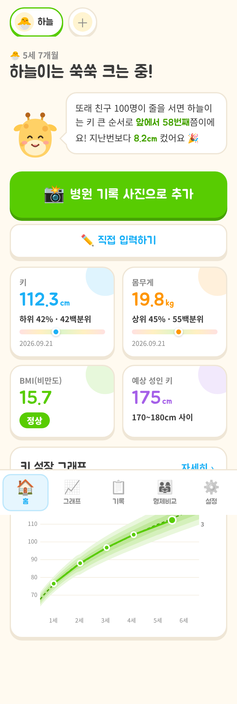
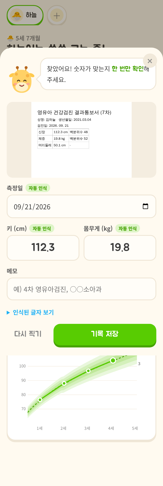
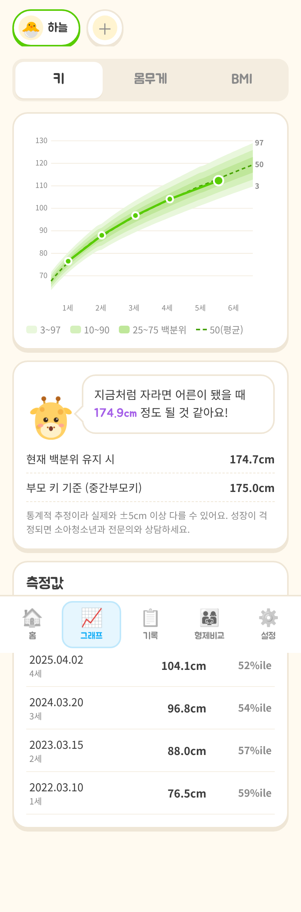
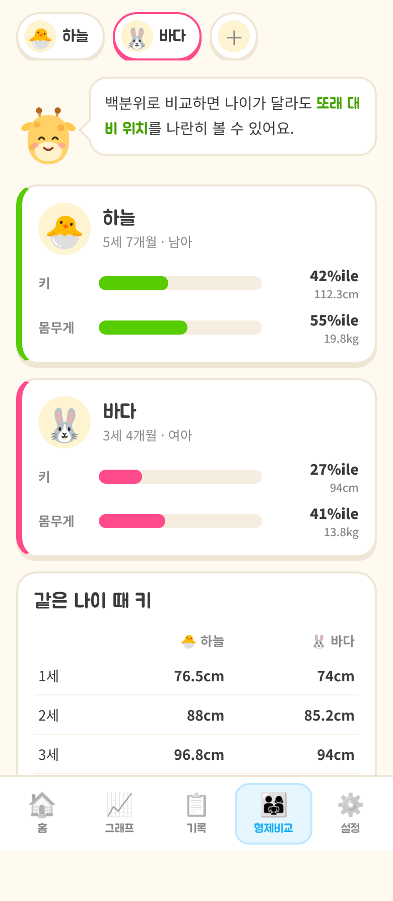

# 쑥쑥 키린 🦒

병원·보건소에서 잰 아이의 키·몸무게를 **사진 한 장으로 기록**하고, 또래와 비교하는 성장 기록 앱입니다.
마스코트 '키린'(아기 기린)이 말풍선으로 결과를 알려주는 귀여운 톤으로 만들었습니다.

| 홈 | 사진 인식 결과 확인 | 성장 그래프 | 형제 비교 |
|---|---|---|---|
|  |  |  |  |

## 주요 기능

- **사진 자동 인식 (메인)**: 영유아건강검진 결과통보서, 진료 기록, 신장계 출력물 사진에서 측정일·키·몸무게를 찾아 채워줍니다. 사용자는 확인만 하고 저장하면 됩니다.
  - 기본: 기기 안에서 인식 (Tesseract.js, 한국어+영어). 사진이 밖으로 나가지 않습니다.
  - 선택: Claude 비전으로 인식 (손글씨·기울어진 사진에 강함, 설정에서 Anthropic API 키 입력)
- **성장 그래프**: 3/10/25/50/75/90/97 백분위 곡선 위에 아이 기록 표시 (키·몸무게·BMI)
- **백분위 비교**: "또래 100명 중 키 큰 순서로 앞에서 N번째"
- **예상 성인 키**: 현재 키 백분위 유지 가정 + (부모 키 입력 시) 중간부모키 평균
- **BMI 판정**: 소아청소년 기준 (5백분위 미만 저체중 / 85 이상 과체중 / 95 이상 비만)
- **형제자매 프로필**: 여러 아이 관리, 백분위 나란히 비교, 같은 나이 때 키 비교
- 백업 내보내기/불러오기, 모든 데이터는 기기(localStorage)에만 저장

## 실행

```bash
npm install
npm run dev      # http://localhost:5173 (OCR 데이터를 public/ocr 로 자동 복사)
npm test         # 단위 테스트 (백분위 계산, 기록지 파싱)
npm run build    # dist/ 정적 파일 생성
```

모바일 웹(PWA)으로 만들어 홈 화면에 추가해 앱처럼 쓸 수 있습니다.

## 기준 데이터에 대해 (중요)

현재 백분위는 **WHO 아동 성장 표준(2006, 0–5세)** 과 **WHO 성장 참조치(2007, 5–19세)** 의 LMS 값으로 계산합니다
(`src/data/who-lms.json`, `scripts/build-who-lms.mjs` 로 생성).

- 질병관리청 **2017 소아청소년 성장도표**도 만 3세 미만은 WHO 표준을 그대로 씁니다.
- 만 3–18세는 한국 아이 자료로 만든 별도 LMS 표가 있습니다. 개발 환경에서 이 표를 받을 수 없어 아직 넣지 못했습니다.
  같은 `[개월, L, M, S]` 형식으로 `who-lms.json` 옆에 넣고 `src/lib/growth.ts` 의 `table()` 에서 3세 이후 구간을 바꾸면 됩니다.
  이걸 넣기 전까지는 "질병관리청 공식 성장도표 기반"이라고 홍보하면 안 됩니다.
- WHO 몸무게 참조치는 10세까지만 있어서, 10세 이후 몸무게 백분위는 표시하지 않고 BMI로 대신합니다.

## 구조

```
src/
  App.tsx                    화면 (홈 / 그래프 / 기록 / 형제비교 / 설정)
  components/
    AddRecord.tsx            사진 선택 → 인식 → 확인·저장 바텀시트
    GrowthChart.tsx          백분위 곡선 SVG 그래프
    Mascot.tsx               마스코트 키린
  lib/
    growth.ts                LMS z점수·백분위·예상 키·BMI
    parseMeasurement.ts      OCR 텍스트에서 날짜/키/몸무게 추출
    ocr.ts                   Tesseract(기기) / Claude 인식
    store.ts                 localStorage 상태 관리
```

## 정식 출시 전에 할 일

- 질병관리청 2017 LMS(3–18세) 반영
- Claude 인식은 지금 브라우저에서 사용자 키로 직접 호출합니다. 출시할 땐 서버(프록시)를 두고 키를 서버에 둬야 합니다.
- 앱스토어 배포가 필요하면 Capacitor 등으로 감싸기
- 이 앱은 참고용이며 의학적 진단을 대신하지 않는다는 고지 유지
