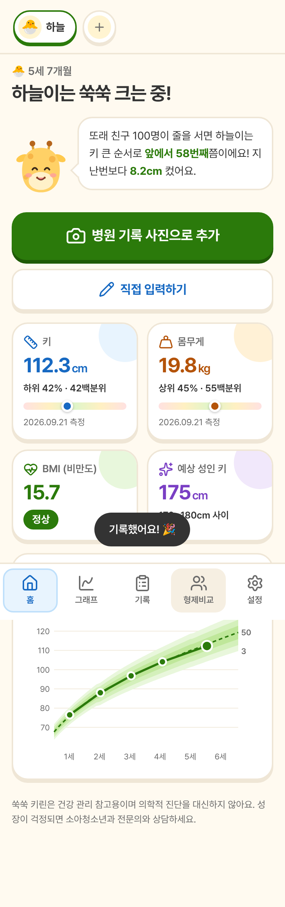
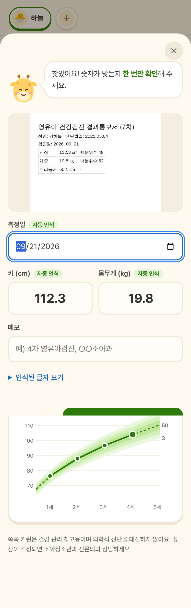
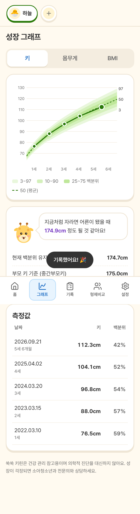
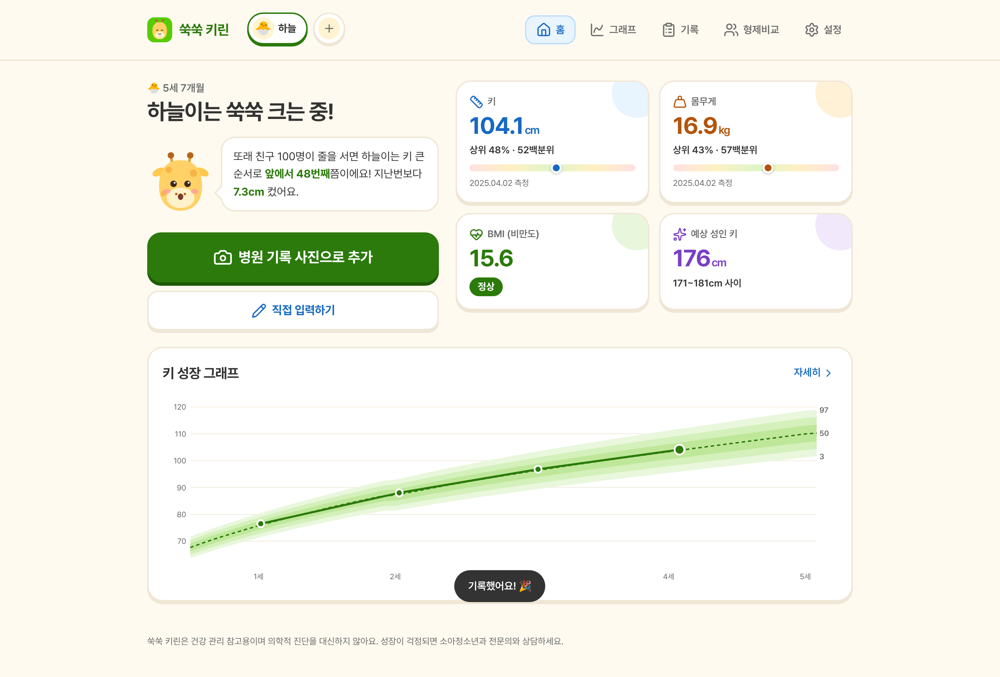
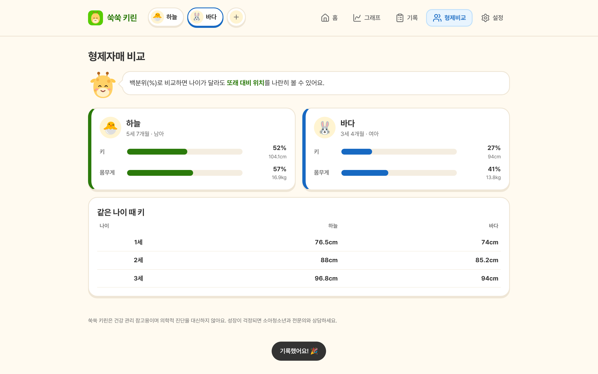

# 쑥쑥 키린 🦒

병원·보건소에서 잰 아이의 키·몸무게를 **사진 한 장으로 기록**하고 또래와 비교하는 성장 기록 웹앱입니다.
마스코트 '키린'(아기 기린)이 말풍선으로 결과를 알려주는 **말해보카 스타일** UI.

**Vanilla HTML + CSS + JS** — 프레임워크·빌드 도구 없음 (`CLAUDE.md` 규칙).

| 모바일 홈 | 사진 인식 결과 확인 | 성장 그래프 |
|---|---|---|
|  |  |  |

| 데스크톱 홈 | 형제 비교 |
|---|---|
|  |  |

## 주요 기능
- **사진 자동 인식 (메인)**: 영유아건강검진 결과통보서·진료 기록·신장계 출력물 사진에서 측정일·키·몸무게를 찾아 채움. 사용자는 확인 후 저장.
  - 기본: 기기 안에서 인식 (Tesseract.js, 한국어+영어). 사진이 밖으로 나가지 않음.
  - 선택: Claude 비전 인식 (손글씨·기울어진 사진에 강함, 설정에서 Anthropic API 키 입력).
- 성장 그래프 (3/10/25/50/75/90/97 백분위 곡선, 키·몸무게·BMI)
- "또래 100명 중 키 큰 순서로 앞에서 N번째", 예상 성인 키, BMI 판정
- 형제자매 프로필 · 백분위 비교 · 같은 나이 때 키 비교
- 백업 내보내기/불러오기 (데이터는 기기 localStorage 에만 저장)

## 실행
빌드가 필요 없습니다. 아무 정적 서버로 루트를 열면 됩니다.
```bash
npm run serve     # = python3 -m http.server 8080 → http://localhost:8080
npm test          # 백분위 계산·기록지 해석 단위 테스트 (node --test, 의존성 없음)
```
> `file://` 로 직접 열면 사진 인식 워커가 막힐 수 있어 서버로 여는 걸 권장합니다.

## 구조
```
index.html
manifest.webmanifest
resource/
├── images/            mascot-{happy,wow,think,sleep}.svg, favicon.svg
│   └── icons/         icon-{name}.svg (Lucide, ISC 라이선스)
├── font/              Pretendard 400/600/700 (woff2, KS X 1001 subset)
├── js/
│   ├── lms-data.js    WHO LMS 표 (scripts/build-who-lms.mjs 로 생성)
│   └── main.js        계산·기록지 해석·화면
└── css/               font → reset → pc → tablet(768~1024) → mobile(~767)
docs/design-system.md  말해보카 스타일 디자인 시스템 (색·타이포·컴포넌트·모션)
tests/main.test.js
```

## 외부 CDN
| 라이브러리 | 용도 | 로드 |
|---|---|---|
| GSAP 3.12.5 (cdnjs) | 마스코트·카드·시트 애니메이션 | `</body>` 직전 |
| Tesseract.js 7.0.0 (jsDelivr) | 기기 내 글자 인식 | 첫 사진 인식 때 지연 로드 |

`prefers-reduced-motion: reduce` 이면 애니메이션을 모두 끕니다.

## 기준 데이터 (중요)
백분위는 **WHO 아동 성장 표준(2006, 0–5세)** + **WHO 성장 참조치(2007, 5–19세)** LMS 값으로 계산합니다.
- 질병관리청 2017 소아청소년 성장도표도 만 3세 미만은 WHO 표준을 그대로 씁니다.
- 만 3–18세 한국 LMS 표는 아직 반영하지 못했습니다. 같은 `[개월, L, M, S]` 형식으로 `lms-data.js` 에 넣으면 됩니다.
  반영 전에는 "질병관리청 공식 성장도표 기반"이라고 홍보하면 안 됩니다.
- WHO 몸무게 참조치는 10세까지라 그 이후 몸무게 백분위는 BMI로 대신합니다.

## 정식 출시 전 할 일
- 질병관리청 2017 LMS(3–18세) 반영
- Claude 인식은 지금 브라우저에서 사용자 키로 직접 호출 → 출시 땐 서버(프록시)로 옮기기
- 실제 휴대폰 사진(흔들림·기울어짐·손글씨)으로 인식률 확인
